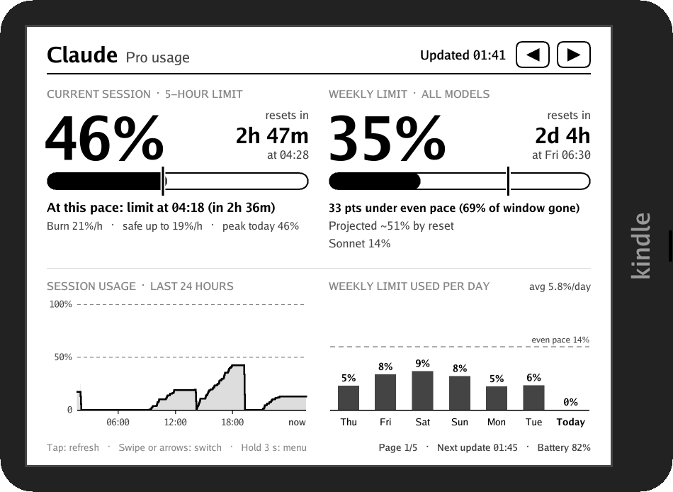

<p align="center"></p>

# kindle-ai-tracker

Turn a jailbroken Kindle into a desk display for your AI plan usage.



See your usage, limits and resets at a glance. Updates every 5 minutes.

## Supported services

- **Claude** (Pro / Max)
- **ChatGPT** (Codex on Plus / Pro / Business)
- **GitHub Copilot**
- **OpenRouter**
- **Z.ai GLM** (Coding Plan)
- **OpenCode Go**

## Requirements

A Kindle jailbroken with the KindleModding hotfix (scriptlets) and FBInk. Built and tested on a Paperwhite 5, firmware 5.19.2.

## Install

**With KPM**, on the Kindle (for example in kTerm):

```bash
kpm add-repo https://me.pratcode.dev/kindle-ai-tracker/manifest.json
kpm install ai_dashboard
```

KPM handles updates (`kpm upgrade`) and removal (`kpm uninstall ai_dashboard`).

**By hand:** download `kindle-ai-dashboard-<version>.zip` from [Releases](https://github.com/prat31/kindle-ai-tracker/releases), and unzip it onto the Kindle drive.

**From source** (needs Go): plug in the Kindle and run `make install`.

The dashboard opens from your library (**AI Dashboard**) or from KUAL. Run it on a wall charger, because a Kindle connected to a computer switches to USB drive mode.

## Usage

1. Open **AI Dashboard** from your Kindle library.
2. Hold a finger on the screen for 3 seconds to open the menu, then choose **Connectors** and pick a service.
3. Follow the QR codes on screen to sign in from your phone.

Once connected:

- **Tap** to refresh.
- **Swipe**, or use the arrows at the top, to switch between services.
- **Hold** for 3 seconds to open the menu: connectors, rotate, refresh, or exit.
- **Offline**, it keeps showing the last readings it fetched, marked **OFFLINE** with when they were fetched.

While awake, the dashboard updates every 5 minutes. To save battery, if nothing changes for 6 updates in a row (about 30 minutes, including time offline), it stops updating and the Kindle goes to sleep. It stays asleep, without updating, until you press the power button; the screen says **press power to wake**. Pressing power while it's awake puts it to sleep the same way. The **Zz** button at the top turns sleeping off (crossed out) and on again: with sleep off, it never sleeps by itself and keeps updating every 5 minutes, even when nothing changes. The sun button next to it sets the front light.

## Configuration

Optional settings live in `ai-dashboard/config.json` on the Kindle:

```json
{
  "refresh_minutes": 5,
  "pause_after": 6,
  "timezone": "Asia/Kolkata",
  "providers": [
    { "id": "openrouter", "monthly_budget_usd": 20 }
  ]
}
```

| Key | Meaning |
|---|---|
| `refresh_minutes` | How often to fetch. |
| `pause_after` | Stop updating and sleep after this many fetches in a row with no change (`0` = never). |
| `sleep_between_updates` | Sleep once updates pause (default `true`); the **Zz** button overrides it. With sleep off, updates never pause. |
| `frontlight` | Front light level while running (default `0`, off; `-1` leaves it alone); the sun button overrides it. |
| `timezone` | Time zone for clock times, e.g. `Europe/London` (`make install` sets it to your Mac's). |
| `full_refresh_every` | Flash the screen every N updates to clear e-ink ghosting (default `6`). |
| `providers` | Per-service options, such as an OpenRouter budget, `"region": "cn"` for Z.ai, or `"plan_label"` to override the plan name Claude shows. |

## Adding a service

Each service is a small package in `internal/provider/` that logs in and returns usage as **meters**, each a percentage of a limit with an optional reset time. The rest of the app (charts, pacing, history, the Kindle screen) works for any service.

To add one:

1. Implement the `Provider` interface from [internal/provider/provider.go](internal/provider/provider.go). `openrouter` is the simplest example for an API key, and `copilot` for a device-code login.
2. Add a blank import for it in `cmd/ai-dash/main.go`.
3. Run `make install`. The service then appears under **Connectors**.

## Development

```bash
make test      # unit tests
make preview   # render every screen with sample data into build/preview/
make dist      # release zip and KPM repository into build/
```

To release, bump `VERSION` and push a matching tag (`v0.1.0`). GitHub Actions publishes the zip, the `.kpkg` and the KPM repository.

Logs from the last 24 hours are kept in `ai-dashboard/dash.log` on the Kindle.
